<p align="center">
  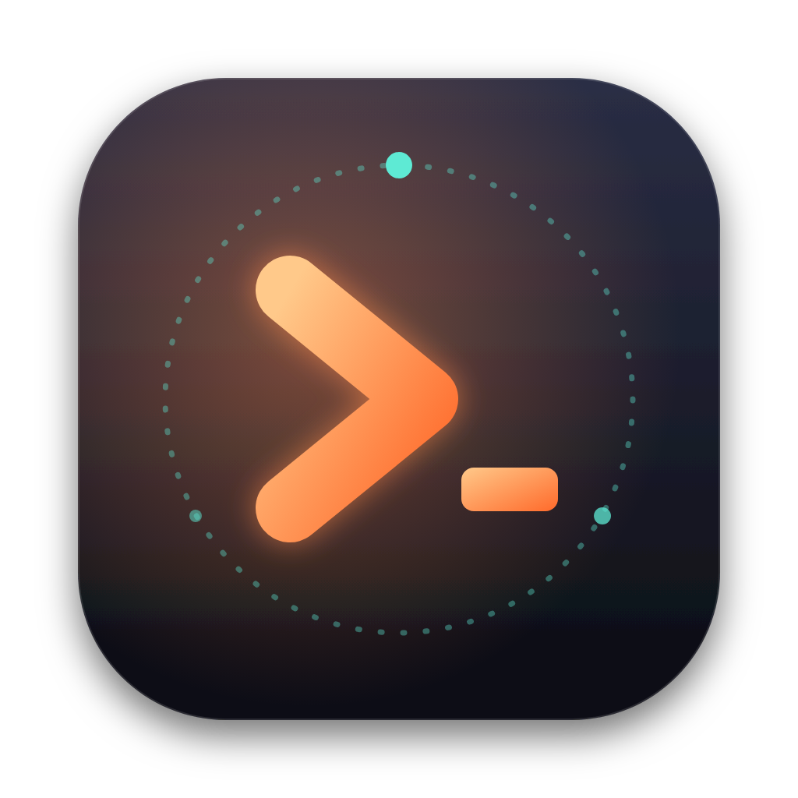
</p>

<h1 align="center">Jaffer</h1>
<p align="center"><b>A calm macOS terminal, with up to four split terminals<br />and a companion that shows what Claude Code is doing.</b></p>

<p align="center">
  <a href="https://github.com/jafforgehq/jaffer/actions/workflows/ci.yml"></a>
  <a href="https://github.com/jafforgehq/jaffer/releases/latest"></a>
  
  <a href="LICENSE"></a>
</p>

<p align="center">
  <a href="#install">Install</a> ·
  <a href="#features">Features</a> ·
  <a href="#companions">Companions</a> ·
  <a href="#claude-code">Claude Code</a> ·
  <a href="#development">Development</a> ·
  <a href="docs/ARCHITECTURE.md">Architecture</a>
</p>

<p align="center">
  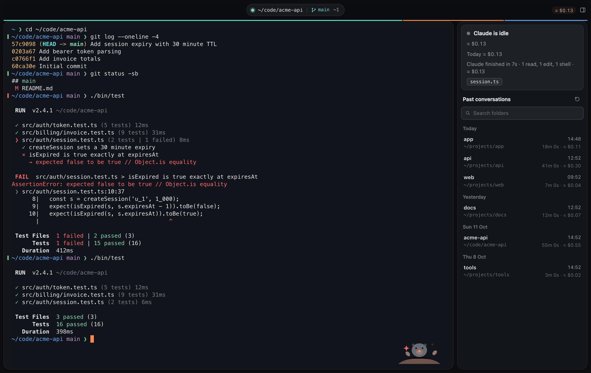
</p>

## Why Jaffer

- **A calm window, up to four terminals.** One shell in a calm window with a thin title bar and one side panel; `⌘D` splits it into up to four terminals, each with its own shell and its own Claude, only when you ask. No tabs, no extra windows and no "new chat". Quitting Jaffer ends every shell and anything running in them: `⌘Q` (the menu's *Quit Jaffer*) asks first when Claude Code or a command is running in any terminal, while a logout, restart or shutdown, or *Quit* in the Dock's menu, end the session without asking. The window's ✕ and `⌘W` do not quit: they hide the window to the menu bar and the terminal runs on (you can change that in *Settings → Appearance → Window*). Nothing of any terminal is saved or replayed, not even how many you had open: the next start is one fresh shell. Since 1.5.0 the side panel's *Terminals* section lists them: click a name to focus it, double-click (or `F2`) to name it, drag a row (or `⌥↑` / `⌥↓`) to reorder, *Split here* opens a new terminal in that folder, *Zoom* (or `⇧⌘↩`) shows one terminal over the whole window, and *Close idle…* ends the terminals where nothing runs (never the focused one). Each terminal has its own companion, and with two or more a terminal that has Claude working or waiting for you gets a coloured outline. The names are kept only while Jaffer runs. Notifications start with the terminal's folder when there are several, and a click on one takes you to that terminal.
- **Life when something happens.** A small animation in each terminal works while a command or Claude works, sits up when Claude needs you and celebrates when a turn ends. Choose a mole, digital rain, an agent network, a starfield, a radar or a reactor core.
- **Claude Code, optional.** It runs inside Jaffer like anywhere else (real TTY, truecolor, mouse, `Shift+Enter`); connect it and the companion, the notifications and a per-answer cost figure follow it. A plain terminal is one click at first launch.

## Install

Download the `.dmg` for your Mac (Apple Silicon `arm64` or Intel `x64`) from [Releases](https://github.com/jafforgehq/jaffer/releases) and drag Jaffer to Applications. Releases are signed and notarized and come with a `SHA256SUMS.txt`; how they are built and published is in [docs/SIGNING.md](docs/SIGNING.md). An unsigned preview built by CI needs `xattr -dr com.apple.quarantine /Applications/Jaffer.app` once.

To build it yourself (a local build opens with no warnings): `./scripts/install-mac.sh` (Node 22+).

**Updates ask first.** The signed app checks for a new release, downloads it in the background and then asks *Update and restart* or *Later*. Updating ends your terminal session (the shell and anything running in it stop and a fresh terminal starts), so the prompt says so, and nothing installs without your yes, not even on quit. The background check can be switched off in *Settings → Updates*.

On first launch Jaffer asks what it may do: sign in to Claude or use a plain terminal, follow Claude Code (its hooks), start `claude` for you. Sign-in opens your browser and nothing more: nothing is installed or typed until you click *Get started*, and a plain terminal installs and types nothing at all.

**Coming from 0.5 or earlier?** Jaffer has been a plain terminal since 0.6.0: the memory, the saved screen, *Resume Claude* and *Restart Claude Code*, the login agent that kept a session running in the background and the Safety edges are gone, and quitting Jaffer ends the shell. The first start cleans up what they left on your Mac, once, and keeps a copy of the two memory files you wrote yourself, if there are any. What it removes and what stays is in the [1.1.1 release notes](docs/releases/v1.1.1.md) (the clean-up is unchanged since 0.6.0).

## Features

| | |
|---|---|
| **Terminal** | A thin title bar: the folder, the git branch and its counts (`+2 ~3 ?1 ↑1`), the command that is running (a ring beside it spins only while something really runs) and, once Claude Code has answered, what the answer cost. A mark beside every command (green when it worked, red when it failed, with its start time and how long it took on hover); right-click it to copy the command or its output, save the output to a file or copy it as Markdown; ⌘↑ / ⌘↓ jump between prompts; scrolled up into long output, the command stays pinned at the top. Pins for up to three lines. Find with a match counter and marks on the scroll bar. Pasting several lines asks first. ⌘-click on a file path (`src/app.ts:12`) shows it in Finder or opens it in your editor; a running dev server gets a `:5173 ↗` chip. Recent commands to copy, also grouped by the folder they ran in. A block's output (with its command) can be copied as an image. A sheet of all shortcuts (`⌘/`). An optional drop-down mode that brings the window down from the top of the screen on the hotkey. Eleven themes that restyle the whole app, previewed live, that can follow macOS or the time of day. A global hotkey and a command palette. |
| **Split terminals** | `⌘D` adds a terminal (up to four: two side by side, three as one and two, four as a grid), each a separate login shell with its own Claude; `⌘1`-`⌘4`, `⌘]` and `⌘[` move the focus, `⇧⌘W` closes the focused one. Each has a small chip with a dot while its Claude runs, its folder and a ✕ (*Restart terminal* on the last one; a question first when something runs there). The layout lives in memory only. [More below.](#the-terminal-and-the-command-line) |
| **Companion** | Six animated scenes, one in each terminal (in four sizes, small to huge), that follow your commands and Claude Code, with a helper per background agent, and a small seasonal touch around Halloween, the winter holidays and Valentine's Day (it can be switched off). It shows what kind of tool Claude is using (reading, writing, the web, an agent), dozes after ten quiet minutes, celebrates when a command that failed three times finally works and flinches at the bell. [More below.](#companions) |
| **Claude Code** | A notification (with a *Show* button) when Claude needs you and when a long turn finishes. A ring that fills against how long a turn usually takes, a thin strip of this turn's tool calls, the file Claude is editing, what a prompt is asking and how often you have answered that tool, optionally answering a permission prompt from Jaffer (experimental, off by default: *Deny* from the notification, *Allow* only in the side panel), a summary when a turn ends (how long, what it did, which files, what it cost), and a cost estimate that grows while Claude works, with today's total and an optional daily budget. [More below.](#claude-code) |
| **Menu bar** | An icon in the menu bar that shows what Claude Code is doing (the mole asleep, digging, or a dot when Claude needs you) and, if you like, a figure beside it (this session's cost, the running turn's time or today's cost). Click it to show or hide the window; right-click for the status, *Show/Hide*, your last five commands (copied, never typed), your last five Claude conversations (their titles; a click copies the resume command), focus mode, settings and *Quit Jaffer* (hold ⌥ for more lines: the cost so far, this turn's tool calls, the git counts). The window's ✕ and `⌘W` hide it to the menu bar and the terminal runs on; *Settings → Appearance → Window* can make them quit or ask instead, and can hide the Dock icon so Jaffer lives in the menu bar only. |
| **Side panel** | A column at the right of the terminal, open by default, `⌘B` or the button at the end of the title bar to show or hide it, drag its left edge to resize it. **Now** shows what Claude is doing: not running, idle, working or needs you, the tool and the turn's time, a bar against a typical turn, the cost so far and today's total against your budget, a line for each background agent, this turn's counts and the files it edited, small bars for the last twenty turns and how long Claude worked today. After an update, a **What's New** card sits above it until you dismiss it. **Past conversations** lists the 50 newest Claude Code conversations by day (the 30 newest with a title, then the folder, the time, how long, an estimated cost); rename one (pencil or `F2`), pin it (star), filter by title, folder or a folder chip, see today's and this week's estimated cost by folder; click or press Enter, and it is resumed in the terminal (`⇧⌘R` resumes the last one): Jaffer types `claude --resume <id>` (with a `cd` first when your shell is in another folder), but only at an idle prompt; while anything runs it copies the command instead. A small button on each row copies it too. A trash button on each row and *Remove…* in the header move conversations to the Trash, after a question (see below). `⇧⌘O` opens the panel on its search. Since 1.4.0 **Now** also has a context meter (*Context 62% of 1M*), what the last five hours cost and a collapsible list of today's turns, and the list has tags, a hide button, a *Storage* view, *Older than 30 / 60 / 90 days…* in *Remove…* and an opt-in search through the text; a third section, **Setup**, lists the focused terminal's MCP servers, skills, rules and memory files, plugins, subagents and hooks. Its data is only what the window already had, plus what the switches in *Privacy and permissions* allow. [More below.](#claude-code) |
| **Awake** | While Claude works, or a command has run for 30 seconds, your Mac does not go to idle sleep (`caffeinate -i`: no password, no admin rights). [More below.](#claude-code) |
| **Quiet** | Focus mode (`⌥⌘F`) fades the chrome and holds notifications until you leave it. An optional glow on the window's edge, an optional strip of CPU, memory and battery in the title bar, and blur behind the window that you can switch off. |
| **Privacy** | *Settings → Privacy and permissions* has a switch for each thing that sends or scans text or acts on Claude Code's files, and says what it does in plain words; the ones that read or send Claude's words start off. [More below.](#claude-code) Nothing of your terminal is written to disk: no screen, scrollback, command history, command output or transcript text. What Jaffer keeps **in memory** while it runs, and loses when it quits: the commands behind the marks and the recent-commands list, pinned lines, the tool calls, counts and timings of Claude's current session, the names of the files Claude edited (never a key, a credential or an `.env` file), today's estimated cost, when each hook was last seen, the menu bar's last five commands, the list of past conversations (with their titles), the folder each recent command ran in, the time Claude worked today, the permission prompts that wait for an answer (their tool and one redacted line, never the request), and since 1.4.0 the layout of your terminals, the context numbers of a session, the last five hours' totals, and the figures behind the Setup list, the Storage view and the Explain card. On disk only settings: among them your own names for conversations and which ones you pinned (`history.names`, `history.pinned`: what you typed, not what a transcript says), which release notes you dismissed, and since 1.4.0 your tags and hidden conversations (`history.tags`, `history.hidden`), the permission switches, the tour and tips state, your budgets and a few numbers for the weekly summary (this and last week's estimated dollars and work time). From Claude Code's own transcripts Jaffer takes the token counts (for the cost) and, for the past-conversations list, only each conversation's id (the file name), its folder, its first and last time and, for the newest 30, its estimated cost and a title (Claude Code's own title or summary line, else the first line of your first message: redacted and cut to 80 characters), and nothing else: never a later prompt, a reply or a tool's input, read-only (the one exception is removing conversations you pick: they go to the Trash, see *Past conversations*), and the list is rebuilt when you ask (the panel opens, a turn ends, the palette opens, `⇧⌘R` runs, the refresh button) and never saved. Beyond that, token counts for the context meter and the last five hours (only with *Show what each answer cost*), file sizes and names for *Storage*, and the words of your and Claude's messages only when you switch on *Search text* (it shows which conversations match, never a snippet) or *Explain* (it sends Claude's latest reply to a helper Claude). Notifications and everything shown redact secrets and never name a command like `env` or `cat ~/.ssh/…`. No API key anywhere: Claude subscriptions only. |

**Keys:** `⌘P` command palette · `⇧⌘C` run Claude Code · `⌘K` clear · `⌘F` find, `⌘G` / `⇧⌘G` next and previous match · `⌘↑` / `⌘↓` previous and next prompt · `⌘R` recent commands · `⇧⌘L` pin the selected line · `⌥⌘C` copy the selection as Markdown · `⌥⌘F` focus mode · `⌘B` show or hide the side panel · `⌘D` split the terminal · `⇧⌘W` close the focused terminal · `⌘1`-`⌘4` focus a terminal · `⇧⌘↩` zoom the focused terminal · `⌘]` / `⌘[` next and previous terminal · `⇧⌘O` past Claude conversations (opens the panel on its search) · `⇧⌘R` resume the last conversation · `⌘/` the shortcuts sheet · `⌘+` / `⌘-` text size · `⌘,` settings · `` ⌃` `` summon Jaffer from anywhere (changeable in *Settings*; in drop-down mode it brings the window down from the top of the screen) · drag a file in to paste its path. `⌘W` and the red ✕ hide the window to the menu bar (or quit, or ask: your choice in *Settings*); `⌘Q` (*Quit Jaffer*, also in the menu bar icon's menu) quits Jaffer **and ends the session**, after asking when Claude Code is working or a command is running in any terminal (the question's default button is Cancel, and Esc cancels). Only that item asks: a logout, restart or shutdown, an AppleScript quit and *Quit* in the Dock's menu end the session **without asking**, and a running Claude Code or command stops. The window has up to four terminals, only when you split it yourself (`tmux` inside a terminal still works as anywhere).

**Settings** (`⌘,`): *Appearance* (themes, following macOS or the time of day with a light theme, font and size, window opacity, blur, window glow, system stats in the title bar, showing the side panel, cursor, *Screen reader support* (Auto, On, Off; since 1.4.1), Option as Meta, animations, the companion, which one and its size, GPU rendering, the global hotkey, keeping the Mac awake while Claude works, opening at login, a *Seasonal touches* switch, and a *Window* group: what closing the window does, the menu bar icon and the text beside it, hiding the Dock icon, and drop-down mode), *Terminal* (command blocks, asking before pasting several lines, a column ruler, the editor link for file paths, inline images, links to local servers), *Claude Code* (sign-in help, connect or disconnect the hooks, *Tell me when Claude finishes*, *Show what each answer cost*, live cost, a daily budget, a daily work-time budget, project budgets, the weekly summary, the tool strip, the turn summary, and which of the eleven hook events Claude Code has sent and when), *Privacy and permissions* (five switches, below), *Help* (the tour, the glossary, tips), *Updates* and *Reset*.

| | |
|---|---|
| 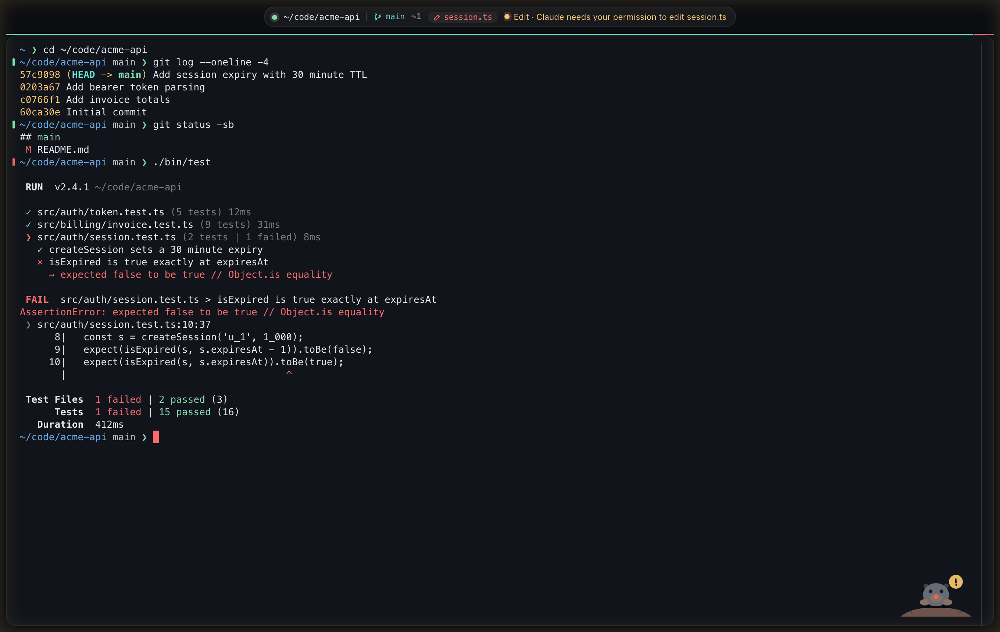<br><sub>**It tells you when it needs you.** The companion sits up with a `!`, the title bar names the tool and what it asks, and a notification follows if the window is behind.</sub> | 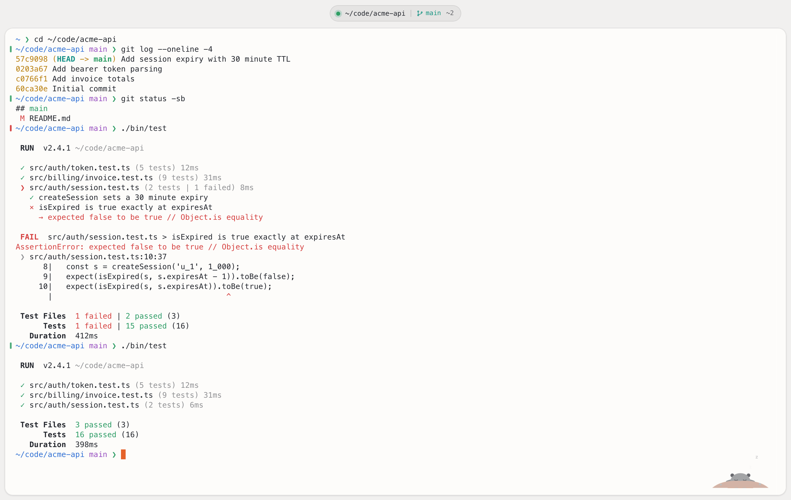<br><sub>**Light theme**, same calm layout (one of eleven).</sub> |
| 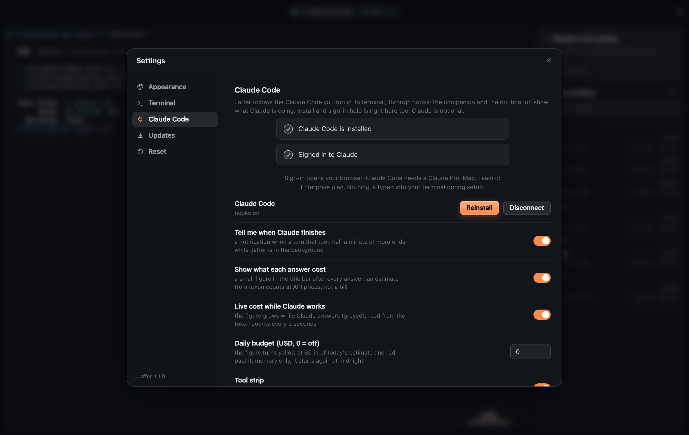<br><sub>**Claude Code settings:** sign-in help, the hooks, the finished notification, the cost switches, a daily budget, the tool strip and the turn summary.</sub> | 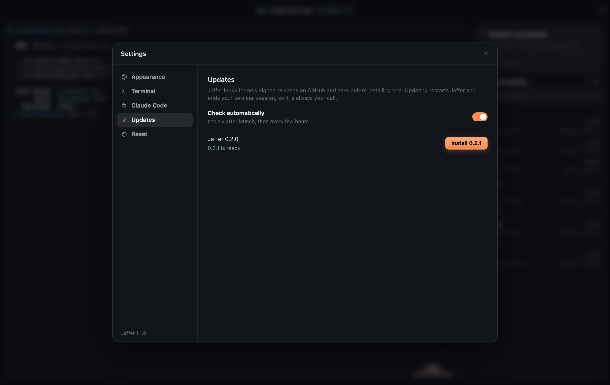<br><sub>**Updates ask first**, because updating ends your terminal session.</sub> |
| 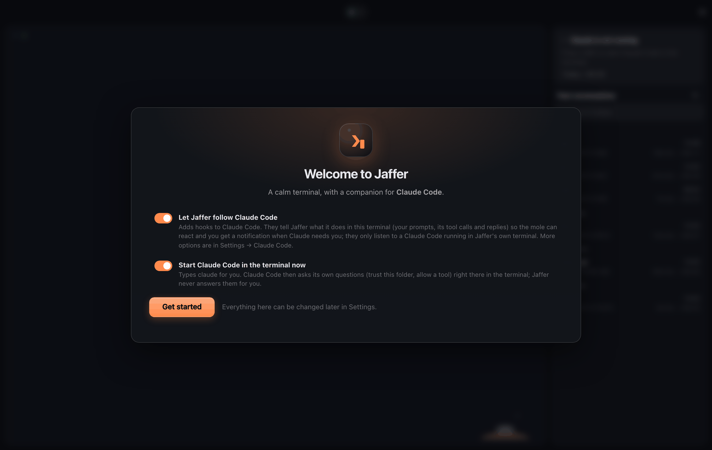<br><sub>**First launch.** Two switches, both yours, then a screen for what Jaffer may do; a plain terminal with no Claude at all is one click on the step before.</sub> | 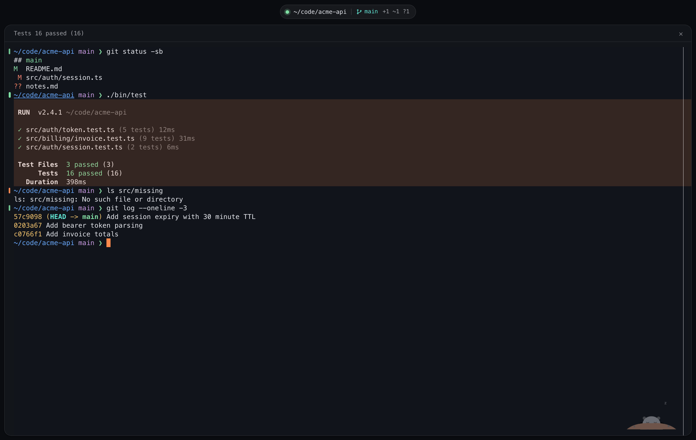<br><sub>**Command blocks.** A mark beside each command (green, red or still running), one block lit under the pointer and a pinned line at the top.</sub> |
| 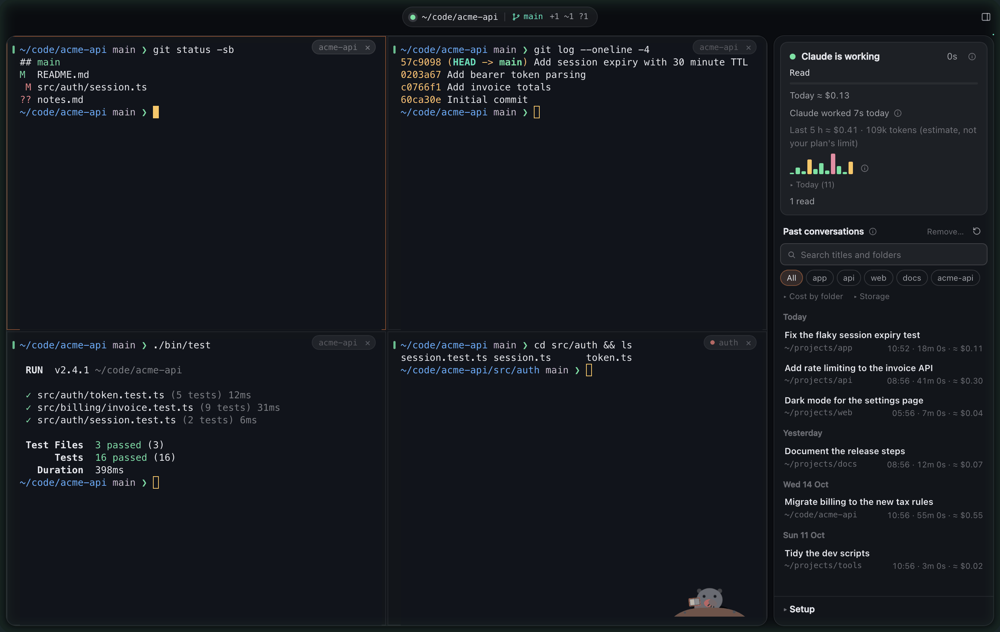<br><sub>**Four terminals.** Each has a chip with its folder and a ✕; the dot on the last one says a Claude is working there.</sub> | 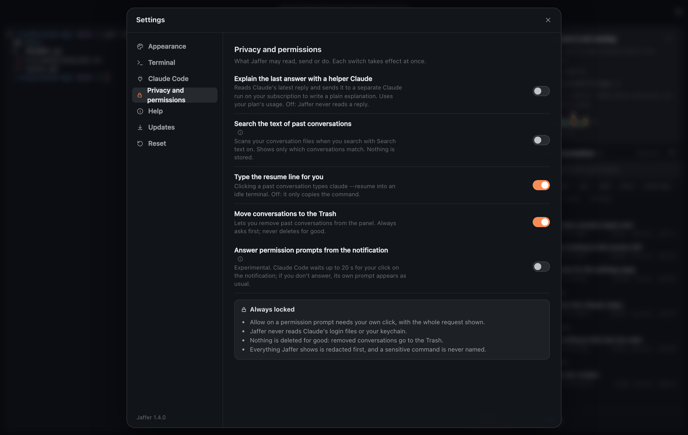<br><sub>**Privacy and permissions.** One switch for each thing Jaffer may read or do, and what is always locked.</sub> |
| 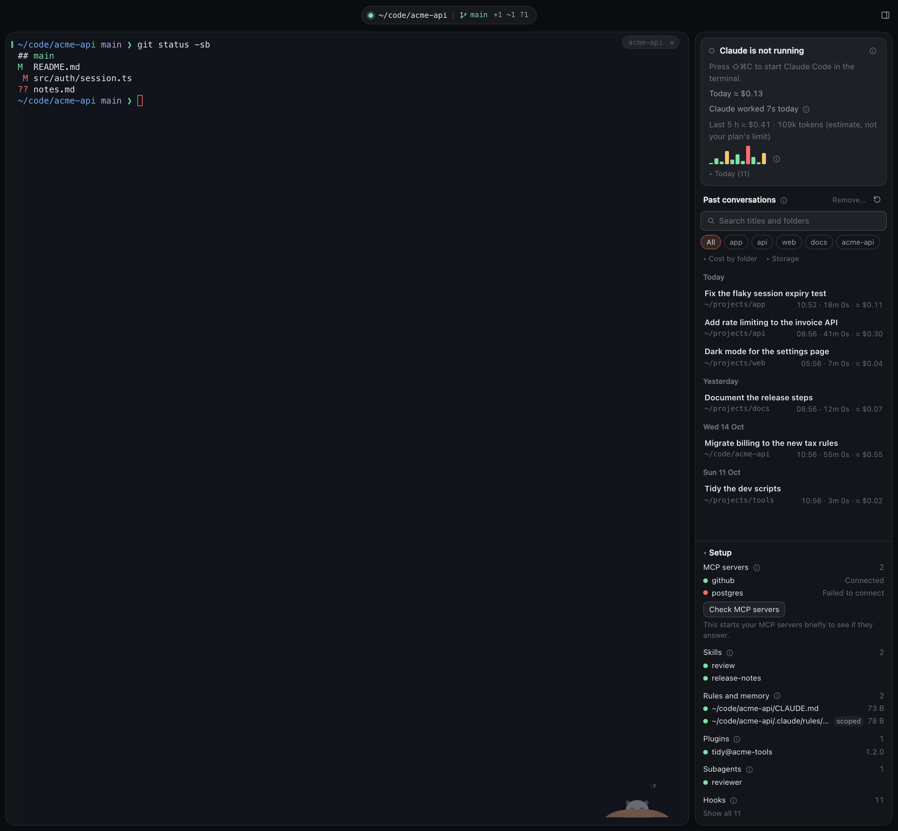<br><sub>**Setup** in the side panel: MCP servers (after a click on *Check MCP servers*), skills, rules, plugins, subagents and hooks of the folder.</sub> | 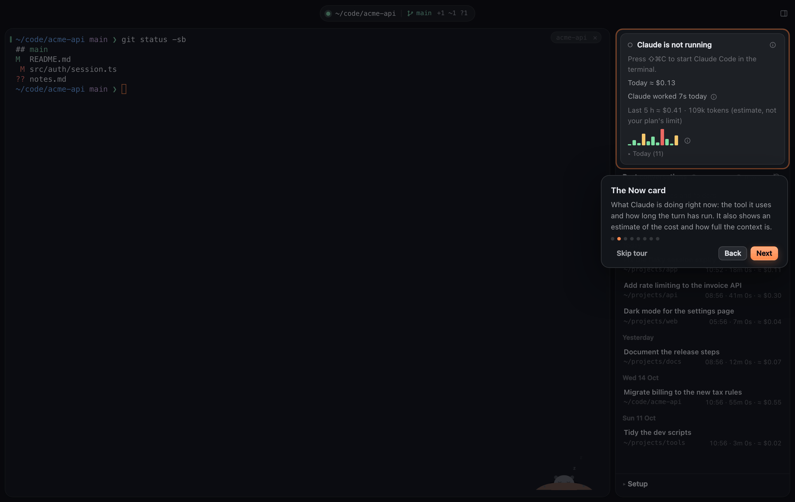<br><sub>**The tour.** A coach mark over the real window: here the Now card.</sub> |

<p align="center">
  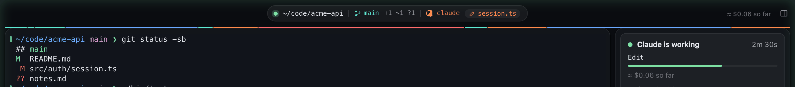
</p>

<p align="center">
  
</p>

<p align="center">
  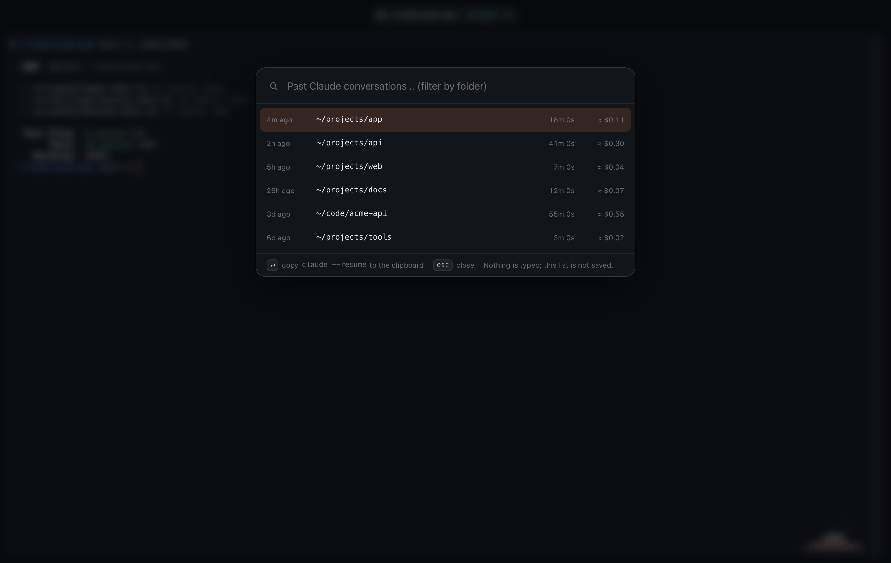
</p>

<p align="center">
  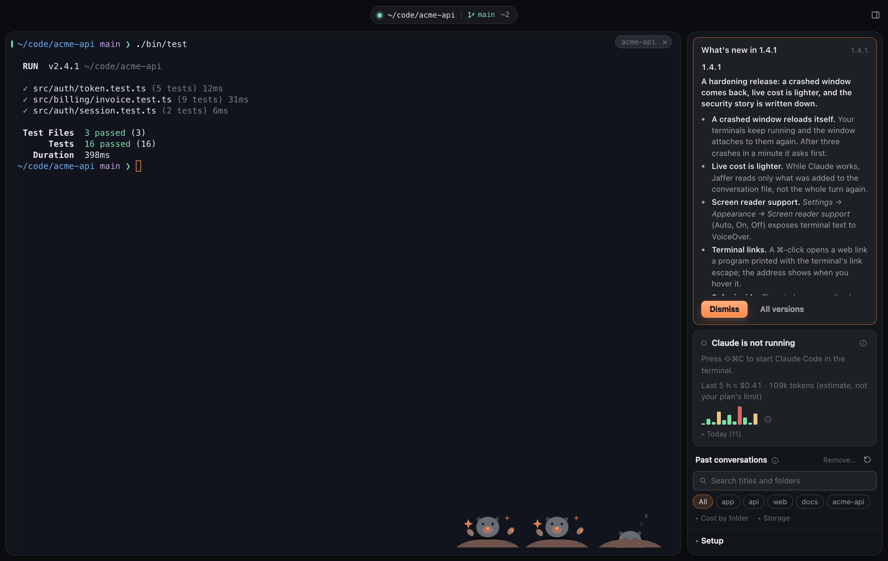
</p>

<p align="center">
  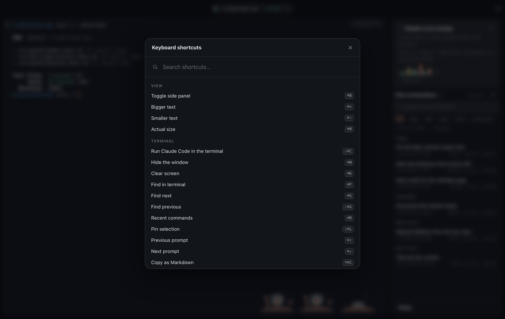
</p>

<sub>The screenshots are the real app, generated by `npm run screenshots` from a scripted demo session (real git repo, real zsh; only Claude Code's hook events, its token counts and, in the title-bar picture, a stand-in for `claude` that just waits are scripted, so the run is deterministic).</sub>

## Companions

Pick one in *Settings → Appearance* (each choice is shown live there), or switch the companion off. *Companion size* (small, normal, large, huge: 0.75, 1, 1.5 and 2.25 times) makes the mole or the scene bigger or smaller, anchored at the bottom right corner of each terminal (since 1.5.0 every terminal has its own, following only its own Claude and commands), and it never takes mouse clicks or moves anything else. A large size is kept to half the terminal's width and height, so on a small window *huge* may show smaller than 2.25 times.

| | | |
|---|---|---|
| <br><sub>**Mole.** Digs while something runs; a helper mole for every agent.</sub> | 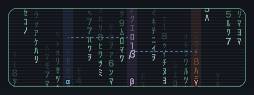<br><sub>**Matrix.** Digital rain; every agent is a bright column.</sub> | 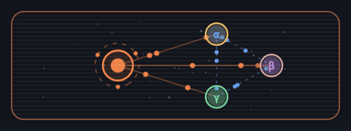<br><sub>**Agent network.** Nodes passing data back and forth.</sub> |
| 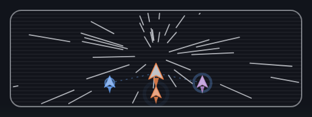<br><sub>**Warp.** A starfield at speed, a wingman per agent.</sub> | 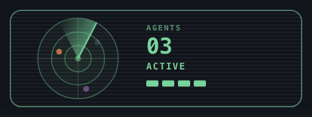<br><sub>**Radar.** A sweep and a blip per agent.</sub> | 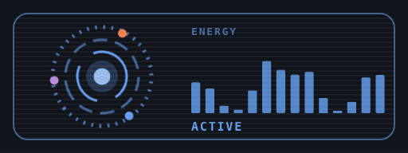<br><sub>**Reactor core.** Rings, energy bars and orbiting agents.</sub> |

<p align="center">
  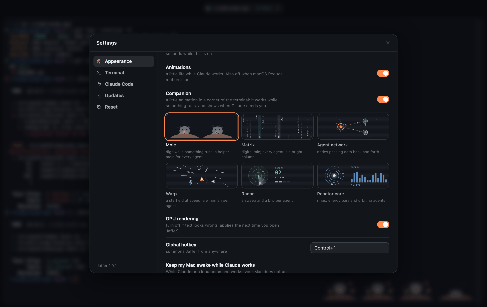
</p>

All six behave the same way. They sleep when nothing runs, rest while Claude Code is open, work while a command or Claude works, sit up with an alert when Claude needs you, and celebrate when a turn ends. **The longer the work takes, the harder they go**: faster after 30 seconds, strained after 2 minutes, at full tilt after 5. **Every background agent brings a helper** (up to three) that celebrates when its agent finishes. **They notice the tool:** the mole shows a book while Claude reads, a hammer while it writes, an antenna for the web and a hard hat for agents (a helper mole shows its own agent's tool), and the scenes change colour or rhythm. After ten minutes of nothing they doze (dimmer, slower) and wake at any activity. When a command that failed three times in a row finally exits 0, a short burst of sparks says so, and a bell makes the companion flinch (and, with the window behind, bounces the Dock icon once).

They are decoration only: they ignore the mouse, stand still with *Settings → Appearance → Animations* off or macOS *Reduce motion* on, take their colours from the theme, and never type or send anything.

## Claude Code

There is one Claude per terminal: the `claude` you run in it (`⇧⌘C`, or just type it; with split terminals each has its own, and the title bar and the panel follow the focused one). You talk to it there, with its own permission prompts; Jaffer adds no second chat or prompt box (its side panel only shows what Claude is doing) and, unless you switch on the experimental permission prompts below, answers none of Claude Code's questions. Claude Code reports what it does through hooks, and Jaffer turns that into the companion, the title-bar ring, the notifications and the cost figure. It follows only a `claude` running in Jaffer's own terminal, redacts everything it handles, and notices a declined prompt or `Esc` from the transcript (Claude Code fires no hook for those).

Jaffer runs on Claude **subscriptions** only: there is no API key anywhere (`ANTHROPIC_API_KEY` is ignored), and whether you are signed in comes from `claude auth status`. Sign-in opens your browser and nothing is typed into your terminal for it. Jaffer types three things into your terminal: `claude`, when you press `⇧⌘C` or leave *Start Claude Code in the terminal now* on at first launch, and, since 1.1.1, the resume line of a past conversation, only after your own click, Enter (in the panel or in the command palette) or `⇧⌘R` (since 1.2.0), and only at an idle prompt (since 1.4.0, in the terminal you are in, and only while *Type the resume line for you* is on) and, since 1.6.0, what you dictated with voice mode (see *Voice*), without pressing Enter.

- **The hooks.** *Settings → Claude Code → Connect* (or `jaffer setup claude`) adds Jaffer's hooks to `~/.claude/settings.json`: eleven events (prompts, tool calls, background agents, notifications, the end of a turn, the start and end of a session, and the moment before Claude compacts its context), all asynchronous, so they never delay Claude, and all of them do nothing outside Jaffer's own terminal. The experimental permission prompts (below) add a twelfth, the one hook that makes Claude Code wait, only while that switch is on. Your own hooks and settings are never touched, only entries tagged `jaffer-managed`; *Disconnect* (or `--remove`) takes them out.
- **What each answer cost.** After every answer a figure like `≈ $0.04` appears in the title bar; while Claude works it grows, greyed (`≈ $0.03 so far`, read from the token counts every 2 seconds, and since 1.4.1 only what was added to the conversation file since the last look; *Settings → Claude Code → Live cost* turns that off). Hover for the tokens, the session total, **today's total** and the cost and length of the last 20 turns as two small lines. Set a *Daily budget* and the figure turns yellow at 80 % of it and red past it (nothing is stopped). It is an **estimate**: Jaffer adds up the token counts in Claude Code's own transcript (numbers only, never the words) at Anthropic's API list prices. On a subscription nothing is billed per token, so read it as what the work would be worth. A model without a known price shows tokens, not a guess, and background agents' own usage is not counted. Today's total and the turn history live in memory and start again when Jaffer quits.
- **What Claude is doing.** While it works, the ring beside the folder fills against how long a turn usually takes (the median of your last ones; before there is one it just spins, and past it the ring stays full and pulses); it turns dotted while Claude compacts its context. Hover it for the session clock (`Claude · 42 min · 9 turns · ≈ $1.20`) and each running agent's time. A 2 pixel strip under the title bar shows this turn's tool calls as segments coloured by kind (red when one failed) and as wide as they took. A pencil chip names the file Claude is editing (click to show it in Finder), and when it needs you the title bar says which tool and what it asks, and "2nd time" when you have already answered a prompt for that tool in this session. **You answer in the terminal: Jaffer answers nothing**, unless you switch on the experimental permission prompts below, and then only after your click on *Allow* or *Deny*.
- **When a turn ends** (10 seconds or more, not cut short) a toast says how long it took, what it did (`3 reads, 2 edits, 1 shell`), the cost, and lists the files it edited (up to five, each a button that shows it in Finder). *Settings → Claude Code → Turn summary* turns it off. Claude's edited files are remembered by name for the session only, never a path that looks like a key or a credential, and nothing else about the files.
- **The side panel.** The *Now* card at the top of the panel (`⌘B`) is the same information as the title bar, in words, for the focused terminal's Claude: the state, the tool and the turn's time, this turn's counts (`3 reads · 2 edits · 1 shell`), up to eight edited files (a click shows one in Finder), the running agents (numbered, never by id), the estimated cost and today's total (with *Show what each answer cost*, and with the same *estimate* note), and the summary when a turn ends. When Claude needs you it names the tool and says to answer in the terminal (or, with the experimental switch, offers *Deny* and, when the request is shown whole, *Allow*). Since 1.2.0 it also draws small bars for the last twenty turns once there are two (the height is how long a turn took, the tint what it cost compared with the others; hover a bar for the numbers) and *Claude worked 1h 12m today*, the time of today's finished turns plus the one running (memory only; it starts again at midnight and when Jaffer quits, and a turn you cut short is not counted). Since 1.4.0 it adds a **context meter** (how full Claude's context was after its last answer, from the token counts of the transcript: *Context 62% of 1M*, yellow from 80 %, red from 92 %, one toast at 85 %; a model Jaffer has no window for shows tokens only), **Last 5 h ≈ $0.41 · 109k tokens** (an estimate, not your plan's limit), a collapsible **Today** list of the last twenty turns and the level of an optional daily work-time budget. These need *Show what each answer cost*, because they read token counts from your conversation files. **What's New:** after an update a card above *Now* shows the release notes you have not seen (from the app itself, nothing is fetched); *Dismiss* hides it, *All versions* lists every version, and *Help → What's New…* and the palette open it any time. Closed, the panel renders nothing and reads nothing; open or closed, the terminal is fitted once per change, not on every pixel of a drag.
- **Past conversations.** The lower half of the side panel. `⇧⌘O` (or *Past Claude conversations…* in the palette, the *Shell* menu and *All Past Conversations…* in the menu bar icon's menu) opens the panel if it is closed and puts the cursor in its search. It lists the last 50 conversations Claude Code has kept for you, newest first under *Today*, *Yesterday* and the date; the ones you pinned (the star on a row, up to 50) come first in a *Pinned* group and stay listed even when they are older. Each row has a **title** in bold (for the newest 30: Claude Code's own title or summary line for the conversation, else the first line of your first message; older rows say *Conversation*) and under it the folder it began in, when it ended, how long it lasted and, for the newest 30 and with *Show what each answer cost* on, an estimated cost (`≈ $0.11`, or a dash when there is none). Type to filter by name, title or folder, or pick a folder chip (*All* and your five most used folders); ↑ and ↓ move. **Rename** a conversation with the pencil or `F2` (Enter saves, Esc cancels): your own name wins over the title in the rows, the search, the palette and the menu bar, and is stored in `config.json` as you typed it. *Cost by folder* (with *Show what each answer cost*) lists today's and this week's estimate for your five busiest folders, from the 30 newest conversations only. In the command palette, two letters or more find conversations too (up to five; Enter resumes). **A click, Enter, or `⇧⌘R` (the newest conversation of your shell's folder, else the newest; it reads the list first) resumes the conversation in the terminal.** At an idle prompt Jaffer clears whatever you had half typed (Ctrl-E, Ctrl-U, then Ctrl-X Ctrl-K, which clears zsh's whole buffer), types `claude --resume <id>` (or `cd '<folder>' && claude --resume <id>` when your shell is in another folder) and presses Enter, says *Resuming…* and gives the keyboard back to the terminal. While any command runs, Claude Code included, **nothing is typed**: the command is copied and a message says why (a busy neighbour terminal does not matter, the focused one does). A folder whose name holds a backslash is never typed: only `claude --resume <id>` is copied. The small copy button on a row copies the same command and types nothing. The resume line goes into your shell's own history like any command you type (Jaffer itself keeps nothing). This is the one thing besides `claude` that Jaffer types into your shell, and only after your click or keypress. Jaffer reads Claude Code's transcripts for this (`~/.claude/projects`, or `$CLAUDE_CONFIG_DIR/projects`) read-only (the one exception is *Remove*, next) and takes nothing but the id (the file name), the folder, the first and last time, the token counts and the title: never anything else you or Claude said, unless you switch on *Search text* or *Explain* (below). The list is read when the panel opens, after a finished turn, with its refresh button, when the palette opens and when `⇧⌘R` runs (with the panel closed, too); a closed panel itself reads nothing. It is never saved.

  **Remove past conversations (1.3.0).** The trash button on a row (or `Delete`/`Backspace` on a selected row) moves that conversation to the Trash; *Remove…* in the header offers *This folder* (while a folder chip is active) and *All listed* (the rows the list shows, so at most the 50 newest and your pinned ones). Jaffer always asks first, in a macOS dialog that names the number, and *Cancel* is the default. It moves only the conversation's own `<id>.jsonl` and its sibling `<id>/` folder (Claude Code keeps a conversation's subagent transcripts and tool results there), **to the Trash, never a permanent delete**: put them back from the Trash and `claude --resume` finds them again. A link is never followed or moved. A conversation that Claude Code is running in Jaffer is refused (*still running*), and if Jaffer cannot check that, nothing is moved. The number in the dialog can be lower than the one in the menu: conversations that are running or already gone are left out. Moved conversations also leave your pins and names. This is the only time Jaffer changes Claude Code's files.
- **Privacy and permissions (1.4.0).** *Settings → Privacy and permissions*, and the last step of first launch, hold one switch for each thing Jaffer may read or do, each with a plain sentence: *Explain the last answer with a helper Claude* (off), *Search the text of past conversations* (off), *Type the resume line for you* (on; off: a click only copies the command), *Move conversations to the Trash* (on; off: no remove buttons), *Talk with Claude by voice* (off; 1.6.0, see *Voice*) and *Answer permission prompts from the notification* (off; experimental, below). **Always locked, with no switch:** *Allow* on a permission prompt needs your own click with the whole request shown; Jaffer never reads Claude's login files (`~/.claude.json`) or your keychain; nothing is deleted for good (removed conversations go to the Trash); everything shown is redacted and a sensitive command is never named. A switch records your consent and keeps Jaffer's own screens, its daemon and its main process in line; it is not a lock against your own processes: any program of your user account can talk to Jaffer's socket or run `jaffer config set permissions.explain true`, exactly as it can type into your terminal.
- **Claude insight (1.4.0).** Besides the context meter and the last five hours (above): a **weekly summary** (when Jaffer starts after a week has ended, once: a notification and a toast say what last week's answers cost and how long Claude worked; *Settings → Claude Code → Weekly summary* turns it off; the money only with *Show what each answer cost*); a **daily work-time budget** (minutes; the *Claude worked … today* line changes colour at 80 % and 100 % and says once when passed); **project budgets** (a line `~/code/app=25` per folder, dollars a week: that folder's row in *Cost by folder* is tinted at 80 % and 100 % and one toast a week says when it is passed; they count only the 30 newest conversations, as the table does, and nothing is ever stopped). The weekly numbers (this week's and last week's estimated dollars and work time) are the only usage figures Jaffer writes to `config.json`.
- **More for past conversations (1.4.0).** *Tags*: a tag button on each row (up to three per conversation, 20 characters each), shown as coloured chips that filter. *Hide*: an eye button per row; hidden ones leave the list and the *Remove…* counts, and *Hidden (N)* shows them dimmed. Tags and hidden ids are in `config.json`, as you typed or chose them. *Storage*: a toggle that shows how much space your conversations take and the ten biggest, each with a trash button (same question, same Trash). *Remove…* also offers *Older than 30 / 60 / 90 days…* (at most 200 at a time, the rest on a repeat). *Search text* (with its switch): the search box can look inside conversations (the 200 newest, at most 2 MB of each, only words you and Claude wrote, not tool inputs or outputs or command output), shows which conversations match and how many times, never a snippet, and keeps nothing. Everything removes the same way as 1.3.0: to the Trash, after a question, never a running conversation.
- **Setup (1.4.0).** A third, collapsed section of the side panel: for the focused terminal's folder, the MCP servers named in its `.mcp.json`, the skills (`~/.claude/skills`, since 1.4.2 also nested up to three folders deep there, where the Claude app puts the skills it syncs, the folder's `.claude/skills` and, since 1.4.2, the skills of your installed plugins, labelled with the plugin; with whether they are on; 300 at most), the rules and memory files (`CLAUDE.md` of the folder and its parents up to your home folder, `~/.claude/CLAUDE.md`, `.claude/rules`: the path, the size and whether a rule is scoped, never the text), the plugins and whether they are enabled, the subagents and the hooks (event names and counts, never the commands). It reads files and starts nothing, and never opens `~/.claude.json`. *Check MCP servers* is the one button that runs something: `claude mcp list` in that folder, which **starts your MCP servers briefly** (25 seconds at most), and shows a state for each; a name is shown, an argument, URL or token never is. Since 1.4.2 the check runs with the `PATH` of the focused terminal's shell as your startup files made it (a Mac app started from the Dock has only `/usr/bin:/bin:/usr/sbin:/sbin`, so servers started with `npx`, `node` or `uvx` were shown as *Failed to connect* although they worked; until a shell has reported its `PATH`, the app's own with `~/.local/bin`, `/opt/homebrew/bin`, `/opt/homebrew/sbin` and `/usr/local/bin` added), and the claude.ai connectors (`claude.ai Gmail` and the like) and plugin servers (`plugin:<plugin>:<server>`) are listed with the others. Servers a project's `.mcp.json` names and you have not approved are listed as waiting for approval and are not started (verified on Claude Code 2.1.302). But when the folder's own `.claude/settings.json` or `settings.local.json`, or your own user-level ones in `~/.claude`, approve project servers in advance (`enableAllProjectMcpServers`, `enabledMcpjsonServers`), Jaffer does not run the check there: it runs it from your home folder and says *This folder's settings pre-approve its project servers, so Jaffer did not check them.* It changes no setting.
- **Explain the last answer (1.4.0, opt-in).** With its switch on, a button in the Now card (after a turn) reads Claude's latest reply (only the words, up to the last 6000 characters, redacted), sends it to a separate `claude -p` run with no tools, no MCP servers and no saved session, in an empty temporary folder, and shows the plain-language answer in a card you can dismiss. It uses your own Claude subscription (and so some of your plan's usage), never an API key. Off, Jaffer never reads a reply. *Ask Claude to explain* only copies a prompt for you to paste in the terminal and is always there. If your Claude Code is too old to run the helper that way, the button is not offered.
- **Learn as you go (1.4.0).** *Help → Glossary…* (and the palette) explains twenty-one words in plain language. Small ⓘ buttons on the panel, the cost, the context meter and a few switches open a short explanation. *Help → Take the Tour* is a one-minute tour with coach marks over the real window (offered once after first launch). The first time something comes up (compaction, *Claude started a helper*, a permission prompt, a full context, a turn over five minutes or a passed budget), a quiet note asks if you want to know what it is (at most one in 90 seconds; *Settings → Help* switches them off).
- **Permission prompts from the notification (experimental, off by default).** *Settings → Privacy and permissions → Answer permission prompts from the notification* adds a twelfth hook, `PermissionRequest`, to `~/.claude/settings.json` (turned off, it is removed again). When Claude Code then asks to use a tool, the hook waits up to 20 seconds for you. While the window is in the background a notification, *Claude asks to use <tool>*, shows one redacted line of what it asks (at most 120 characters) with the buttons **Show** and **Deny** (the notification never offers Allow); the title bar and the Now card show the question with a countdown. **Allow** is offered only in the Now card, next to the whole line, only when the request is shown whole (not for a cut line, a masked secret, a sensitive command or file, or a tool with nothing to show), only 0.75 seconds after it appeared, and only to a real mouse click, never the keyboard or a script. Edits and writes of files (*Edit*, *Write*, *MultiEdit*, *NotebookEdit*) never get *Allow* from Jaffer, because what they would write is not shown (and a settings, shell or hook file could widen what Claude may do): *Deny* or *Answer in terminal*. **Deny** is always safe. *Show*, *Answer in terminal*, 20 seconds of silence, the setting off, Jaffer closed or any error: Jaffer prints nothing and Claude Code's own prompt appears as usual. Jaffer never allows by itself and has no "always allow". Any program of your user account can talk to Jaffer's socket (as it can type into your terminal through it), so this is a convenience with care taken, not a security boundary. macOS keeps the text of delivered notifications in its own notification database, like any notification's.
- **Notifications** while the window is in the background: Claude needs you, a long turn finished, a long command finished. The first two have a *Show* button (and a click does the same) that brings the window back, also a hidden one. *Tell me when Claude finishes* in *Settings → Claude Code* switches the finished-turn one off. In **focus mode** (`⌥⌘F`; `⌃⌘F` is macOS's own full screen) they are held, and when you leave it one notification says what you missed (`While you were focused: Claude finished twice, 1 command failed`). A command that finished while the window was behind also gets a toast when you come back.
- **Closing the window does not stop it.** The red ✕ and `⌘W` hide the window to the menu bar and Claude Code runs on; the icon, your hotkey or a notification's *Show* bring the window back. (In full screen, the window leaves full screen first, so no empty Space is left.) The first time, one notification says where Jaffer went. With *Drop-down mode* on (it needs the hotkey), the hotkey brings the window down at the top of the screen under the pointer, the full width and about 45 % of the height, and it hides when you click elsewhere; your normal window size and place are untouched and come back when you switch it off.
- **Quitting stops it.** Claude Code runs in Jaffer's terminal, so it ends with it. `⌘Q` (or *Quit Jaffer* in the menu bar icon's menu) asks first while Claude is working or a command runs in any terminal; a logout, restart, shutdown or the Dock's *Quit* do not (macOS takes a question at logout as the app refusing to quit and cancels the logout), so save your work before you log out with Claude running.
- **Awake while Claude works.** While Claude (or a background agent) works, or a command in any terminal has run for 30 seconds or more (not an interactive program such as `ssh`, `vim` or `tail -f`; capped at 6 hours), Jaffer holds the Mac off idle sleep with `caffeinate -i`, no admin rights and no password, and lets go 15 seconds after the work stops. The screen can still sleep. **It does not override the lid:** a laptop on its own with the lid closed still sleeps, and everything pauses until it wakes. With power, an external display and a keyboard or mouse (macOS's closed-display mode) it keeps working; that has not been checked on a real Mac yet. *Settings → Appearance → Keep my Mac awake while Claude works* switches it off.

## Voice

Off by default (1.6.0). Voice mode reads the prose of Claude's finished replies aloud and types what you say into Claude's prompt. English only.

- **Turn it on:** *Settings → Privacy and permissions → Talk with Claude by voice*. Jaffer asks first, then downloads about 175 MB of speech models once (Kokoro for speech, Whisper base.en for listening) into `~/.jaffer/voice/`, over https from `huggingface.co` or its `.hf.co` servers only, each file checked against a SHA-256 built into the app. Turning the switch off stops a download and ends voice mode; *Remove voice files* deletes the folder. Every install carries the speech runtime (a ~21.6 MB WebAssembly file and a ~5 MB worker) even with voice off.
- **Use it:** `/voice` in the command palette (`⌘P`) turns voice mode on for the terminal you are in, and again turns it off. There is no hotkey and no title-bar button. When Claude finishes a turn there, Jaffer speaks the prose of the answer (code, paths, tool output and links are skipped), then listens: speak, and pause for about a second and a half. macOS asks once for microphone access. The Now card in the side panel shows what voice is doing, with a *Stop* or *Turn off* button. Jaffer listens only when voice mode starts with Claude idle and once after each finished turn; it never listens in the background or on a wake word.
- **Dictation is typed without Enter.** It goes into the terminal where voice started, only if you are still in that terminal and Claude Code is idle there; text starting with `/`, `!` or `#` is copied instead of typed, and so is anything that arrives while Claude is busy, with a note that says why. You read it and press Enter yourself.
- **Keys:** `Esc` cancels a recording or stops speech; `Esc` twice in a row leaves voice mode.
- **What leaves the Mac:** only the model download above. Audio is kept in memory for one recording and dropped after it is turned into text; neither audio nor text is written to disk. The window itself refuses every network request. See [SECURITY.md](SECURITY.md).
- **Licence:** the speech engine bundles espeak-ng, which is GPL, so Jaffer is GPL-3.0-or-later.

## The terminal and the command line

**Split terminals (1.4.0).** `⌘D` (*Shell → Split Terminal*, or the palette) adds a terminal in the folder of the one you are in, up to four: two side by side, three as one on the left and two stacked on the right, four as a grid, all the same size. Each is its own login shell with its own screen and its own Claude. `⌘1` to `⌘4`, `⌘]` and `⌘[` move the focus (a thin outline marks it; typing, find, the command marks, the title bar and the side panel follow it) and `⇧⌘W` closes the focused terminal. Each terminal has a small chip at its top right: a dot while a Claude runs in it (working, or needs you), its folder, and a ✕. The ✕ ends that terminal's shell; on the last one it reads *Restart terminal* and gives a fresh shell in the same folder. If a command or Claude runs there, a question appears under the chip (*A command is running: …*, with *End terminal* and *Cancel*; Cancel is the default and Esc cancels); nothing running, no question. The layout lives in memory only: how many terminals you had is not saved, and the next start is one. The port chip and the find bar follow the focused terminal, and a window at its smallest size with four terminals leaves about 18 columns each.

**What the terminal adds.** *Command blocks* read the shell's own marks (zsh, bash and fish, as Jaffer's shell integration emits them) on the window's side: after a re-attach or a clear they start again, and a program in the full-screen mode (`vim`, `claude`) is one block. They do not fold output (the terminal has no folding). *Pasting several lines* asks first (*Paste* or *Cancel*), and dropping a file still pastes its path. A *file path* that a program prints is clickable with ⌘ (`path`, `path:line`, `path:line:col`; absolute, `~/` or relative to your folder): it shows the file in Finder, or opens it in the editor you choose in *Settings → Terminal* (`vscode://file/{path}:{line}:{col}`; only editor links such as VS Code, Cursor, Windsurf, Zed, IntelliJ, Sublime and TextMate are allowed). Jaffer never opens or runs a path a program printed. *Recent commands* (`⌘R`) lists this session's commands (a *By folder* switch groups them by the folder each ran in) and **copies** the one you pick: nothing is typed for you. *Copy as image* in a mark's right-click menu draws the command (not a sensitive one) and up to 200 lines of 160 columns of its output on a canvas in your font and colours and puts the PNG on the clipboard; nothing is saved. `⌘/` (or *Help → Keyboard Shortcuts*) opens a searchable sheet of every shortcut. *Images* in the terminal (sixel and iTerm2 inline images) work and can be switched off; **Kitty graphics are not supported**. *Git counts* come from `git status` after each prompt (1 second at most, no lock taken; a repository whose own config names a filter program, as Git LFS can when configured locally, shows no counts, and on a Mac without the developer tools git is not run). A running server's `localhost:5173` gets a chip in the title bar.

**Links, and a window that comes back (1.4.1).** A ⌘-click on a printed `http(s)` address, or on a hyperlink a program printed with a hidden address (OSC 8), opens it in your browser; the address of such a link shows as a tooltip when you hover it, and a link with a login in the address, or longer than 2048 characters, is refused with a short reason. Files and other kinds of link are not links. If the window's page crashes or hangs, Jaffer reloads it and your terminals appear again as they were (they live in `jafferd`, not in the page); the first three crashes within a minute reload it, and the fourth asks first (*Reload* or *Quit*). A hang counts when the page is still unresponsive ten seconds after Electron reports it.

The app is a window onto `jafferd`, a process it starts as its own child: it owns your shells, a headless copy of each screen and what Claude Code is doing in each, and it ends with the app (quit, crash or kill). Re-attaching the window, after a page reload say, restores the exact screen, including full-screen programs. If a shell exits, a fresh one starts in the same folder with a blank screen (unless you closed that terminal).

```sh
jaffer status | doctor    jaffer setup claude [--remove|--status]
jaffer config get|set <dot.path> <json>    jaffer daemon [status|stop]
```

The command line talks to the running app and never starts a terminal. With Jaffer closed, `status` and `doctor` say it is not running and `daemon start` fails (*Jaffer is not running. Open Jaffer and run this again.*); `setup claude` fails the same way only when `~/.jaffer/bin/jaffer`, the wrapper the app writes when it starts, is missing, while `setup claude --status` and `--remove` always work; `config get|set` fall back to `config.json`. `daemon stop` ends the session, which quits the app with it. Inside Jaffer `jaffer` is already on your `PATH`; elsewhere run *Install the `jaffer` command* from the palette.

**Start over:** *Settings → Reset → Reset…*, or `jaffer reset` from another terminal (`--yes` skips the question, `--delete` skips the backup). It ends the session and removes `~/.jaffer` (moved aside as `~/.jaffer.backup-<time>` unless you delete it), Jaffer's hooks in Claude Code, the `jaffer` link and the app's data, together with anything an older Jaffer left behind (its login agent, its memory tools in Claude Code, the block it wrote into `~/.claude/CLAUDE.md`, the skills it published). Claude Code itself, its login and your own settings stay. If `~/.jaffer` is a link, Reset renames or removes the link, not what it points to. Then drag Jaffer.app to the Trash.

## Development

```sh
npm ci && npm run build        # esbuild: daemon, CLI, Electron main/preload, renderer
npm run dev                    # build + launch
npm run typecheck && npm test  # real PTYs (bash, zsh), the bundled daemon and CLI as processes, the real `claude` where it is installed
npm run test:e2e               # the real UI in headless Chromium against the real daemon (set JAFFER_CHROME)
npm run screenshots            # regenerate docs/screenshots (temp homes; needs a short TMPDIR and JAFFER_CHROME); then python3 scripts/shrink-screenshots.py
scripts/release-mac.sh         # on your Mac: build, sign, notarize, verify; --publish uploads it
```

**Careful when you run the app from a checkout:** `npm run dev`, `npm start` and `npm run smoke` use your real `~/.jaffer`, and on a Mac that ran an older Jaffer (0.5 or earlier) the first start cleans it up for real (it deletes the old memory and saved session there). Give them a throwaway folder: `JAFFER_HOME=/tmp/jaffer-dev npm run dev` (the name must contain "jaffer"). That protects your Claude Code files and launchd from the first-start clean-up only (it touches `~/.claude`, the login agent and the MCP server only for the default home). A run with a throwaway `JAFFER_HOME` can still write hooks into your real `~/.claude/settings.json` (the first-run switch *Let Jaffer follow Claude Code* and *Settings → Claude Code → Connect*, pointing at that home's wrapper), and *Settings → Reset* or `jaffer reset` remove the real hooks, MCP server, `CLAUDE.md` block and skills of Jaffer's from your real `~/.claude`. *Settings → Reset* and `jaffer reset` also remove Jaffer's app data under your real `~/Library` (Application Support, Preferences, Saved Application State, Logs, Caches and the update cache), and the palette's *Install the `jaffer` command* links `~/.local/bin/jaffer` to that home. For experiments use a throwaway `HOME` as well, as the tests do: `HOME=/tmp/jaffer-x JAFFER_HOME=/tmp/jaffer-x/.jaffer npm run dev`. The tests use temporary homes, and `JAFFER_NO_LAUNCHCTL=1` keeps them away from the real `launchctl`.

`src/core` has no Electron dependency, so nearly everything is tested as real processes. CI runs the suite on Linux and macOS, builds the `.app`, boots it in a smoke test (`JAFFER_SMOKE=1`) and checks signing end to end with a throwaway identity. See [docs/ARCHITECTURE.md](docs/ARCHITECTURE.md) and [CLAUDE.md](CLAUDE.md) for the layout and the rules that matter.

**Not verified here:**
- a real Claude sign-in (tests use the real `claude` binary against a mock API and a stand-in for the login page);
- the companions and the cost figure against a real Claude Code session (their inputs were checked against real hook payloads and transcript fields, then driven by scripted events);
- clicking *Update and restart* through to the new version;
- needing a person at a Mac: notifications, the global hotkey and the WebGL renderer on your GPU;
- **the first start on a Mac that ran an older Jaffer (0.5 or earlier; the clean-up shipped in 0.6.0 and 1.0.0 repeats it)**, with its login agent, its Claude Code settings, its memory data and a session still running. The clean-up is tested on seeded temporary homes against a stand-in `launchctl` and a stand-in `claude`, because the real ones would touch your LaunchAgents and your Claude Code. Not checked on a real Mac: a real `launchctl bootout` of an installed agent, a real `claude mcp remove jaffer -s user` (its exit code and message when nothing was registered), and the dialog offering to end an older Jaffer's background session when a real one is still running;
- **the child ending when the app is killed:** quitting and crashing are tested with real processes, and a `SIGKILL` of the parent only with a Node stand-in for the app, not with the real Electron app;
- **the packaged app's own dialogs:** the quit question (`⌘Q` with Claude Code or a command running), the question about an older Jaffer's session and the terminal-stopped dialog are type-checked and built, and their decisions are unit-tested, but the dialogs themselves have not been clicked on a real Mac (CI's smoke test boots the packaged app and checks that its terminal is the app's own child). That includes what Return and Esc do in the first two, where one button is both the default and the cancel button (Cancel in the quit question, Quit in the other): they are meant to end nothing;
- **quitting without a question:** a logout, restart or shutdown with Claude Code or a command running (the session should end and the logout go on, without a question), the Dock's *Quit*, and an AppleScript quit;
- **Settings → Reset in the packaged app** (it stops the terminal, removes what it removes and relaunches the app);
- **starting 1.0.0 while the older Jaffer app is still open:** the second-instance guard should make the new app exit at once and bring the old window forward, so quit the older Jaffer first;
- **staying awake on a real Mac:** `pmset -g assertions` showing the hold while Claude works and not after, and a closed lid with and without power and an external display (the tests use a stand-in for `caffeinate`).

- **1.0.0's additions, checked only in headless Chromium (the real renderer against the real daemon) or with stand-ins, not in the packaged app on a Mac:**
  - the tooltips and clicks in the title bar under macOS's drag regions (the elements are marked no-drag and that is checked through computed style, not by hovering a real window);
  - `setVibrancy(null)` with *Blur* off, and the opaque colours that go with it;
  - `⌘↑`, `⌘↓`, `⌘G`, `⇧⌘G`, `⌘R`, `⇧⌘L`, `⌥⌘C` and `⌥⌘F` arriving through the real macOS menu (the tests call the same actions through a shim);
  - the resource strip and the battery on real hardware (a desktop Mac should show no battery; the Chromium run reports one), and the five-second sampling in the app's main process;
  - *Follow macOS / time of day* on a real Mac (the system's light and dark appearance and the clock; the tests emulate both) and the 1 second crossfade;
  - what the scroll bar's marks for search matches look like at your sizes;
  - ⌘-clicking a path into a real editor through its link (the tests check the link that is opened, and the Finder reveal, not the editor);
  - focus mode's held notifications and the one summary notification in the packaged app, and the Dock bounce for the bell and for *needs you* (not exercised: it needs a person and a Dock);
  - the git guard on a real Mac without the developer tools (`xcode-select -p` failing), and git status in repositories with unusual configuration;
  - the first start after updating: the hooks get their eleventh event (`PreCompact`) when the new app's terminal starts, tested on temporary homes, not on a real `~/.claude/settings.json`;
  - the sticky header, the gutter marks and the overview ruler with the WebGL renderer on a real GPU (the UI tests and the screenshots use the DOM renderer).

- **1.0.1's additions** (the menu bar item and the close behaviour are Electron wiring that no test here runs: the pure parts, such as the close decision, the icon's states, the menu's text and the clipboard strings, are unit-tested, and the list of past conversations is checked in headless Chromium against the real daemon, but the pieces below have not been used on a real Mac):
  - the menu bar `Tray` itself and its icons: that the generated template icons appear and are tinted right in a light and a dark menu bar, at 1x and 2x, and the 500 ms digging animation and the three flashes for *needs you*; the text beside the icon (monospaced digits, the 1 second tick of the running time);
  - the menu: a right-click opening it, what ⌥ held at that moment adds (whether the modifier arrives on a right-click), the clicks on its items, and the *Past Claude Conversations* lines waiting up to 400 ms for the daemon on the first, cold call;
  - leaving full screen and hiding across Spaces (the 2 second fallback if macOS never reports that it left), and showing the window again afterwards;
  - hiding the Dock icon: whether the window stays usable, and whether `⌘Q`, `⌘W` and the global hotkey keep working while Jaffer is an accessory app with no Dock icon;
  - the notifications' *Show* button (macOS lists it only under *Options* in some notification styles) and the one notification shown the first time the window hides;
  - the *Ask* dialog (*Hide to Menu Bar* / *Quit Jaffer* / *Cancel*, where Cancel is both the default and the cancel button), in full screen too;
  - `⇧⌘O` through the real menu (the tests call the same action through a shim);
  - the past-conversations list against the transcripts that real Claude Code versions write (the tests plant files in the layout the cost reader was checked against: `projects/<folder>/<session id>.jsonl` with `cwd`, `timestamp` and `usage` fields; a version that lays them out differently would show fewer or no rows, never wrong text).

- **1.1.0's additions** (the side panel is checked in headless Chromium with the DOM renderer against the real daemon, with injected Claude state and planted transcripts; its pure parts are unit-tested; nothing below has been seen in the packaged app on a real Mac):
  - the panel's look with the window's blur and vibrancy on (`setVibrancy`) and with *Blur* off, in each theme, and the card and handle edges on a Retina display;
  - the resize feel at the panel's edge in a real window (the 6 px handle's hit area, the cursor, the terminal catching up once on release) and the 180 ms slide with a real GPU;
  - `⌘B` through the real macOS menu: the View menu's accelerator and the page's own key handler both fire, and the 250 ms guard should make one press one toggle (the tests call the same action through a shim and press the key in Chromium, never through Electron's menu);
  - the title-bar button's drag-region behaviour (it is marked no-drag and that is checked through computed style, not by clicking a real window), and the keyboard staying in the terminal after a click on it;
  - the menu bar menu's five newest past conversations, loaded when the icon is made, on a Mac with a real Claude Code history, and *All Past Conversations…* opening the panel;
  - the panel's list against the transcripts that real Claude Code versions write, and the Now card against a real Claude Code session (its agents, its files, its cost) rather than injected state.

- **1.1.1's additions** (titles and resume are checked in headless Chromium against the real daemon, with a real bash and a stand-in for `claude`, and their pure parts are unit-tested; nothing below has been seen in the packaged app on a real Mac):
  - titles against the transcripts that real Claude Code versions write: the shapes of a summary line, an `aiTitle` and a `customTitle`, taken from what is known of the format, are unchecked across versions (a version that writes them differently would show the first message's first line, or *Conversation*, never other text);
  - typing the resume line into a real zsh or bash prompt on a Mac with your own configuration (vi mode, a multi-line or custom prompt, plugins, a different `PS2`), and what `cd '<folder>' && claude --resume <id>` does in a shell that has a `cd` function or alias;
  - an accepted risk of "only at an idle prompt": Jaffer knows the prompt is idle from the shell's own marks (OSC 133/633), so a program that prints forged marks can fake an idle prompt, and a continuation prompt (`PS2`, after an unclosed quote) and the shell's vi command mode count as idle too: a click there types the line into what the shell is waiting for. The copy button is the safe way in those cases.

- **1.2.0's additions** (checked in headless Chromium with the DOM renderer against the real daemon, in unit tests and with stand-ins for `claude`; the pieces that are Electron wiring in the main process (the menu, the menu bar item, the window, the notifications) are typechecked and read, not run; nothing below has been seen in the packaged app on a real Mac):
  - the *What's New in 1.2.0* line in the menu bar icon's menu and *Help → What's New…* and *Keyboard Shortcuts* in the real macOS menu (the tests call the same actions through a shim);
  - **drop-down mode on a real Mac:** several displays (the one under the pointer, a display to the left or above, the work area under the menu bar and the Dock), Spaces, over a full-screen app, the race between a tray click (which blurs, and so hides, the window) and the click's own toggle, system prompts and dialogs that take the focus (the window hides on blur unless a dialog of Jaffer's own is open), `⌘M`, hiding the Dock icon at the same time (*Only in the menu bar*), and the window the hotkey makes when it did not exist;
  - **the notification's action buttons and their order** (*Show*, *Deny*) on macOS: some notification styles show actions only under *Options*, and the index of the pressed button comes from Electron;
  - **Claude Code's real `PermissionRequest` hook:** that it waits for Jaffer's hook before it draws its own dialog, that printing nothing and exiting 0 brings its own prompt back, that the decision JSON is honoured, what happens to a hook that Claude Code kills at its 25 second timeout, and whether it also sends a *needs you* notification while Jaffer's hook waits. The behaviour is taken from its documentation; no test runs the real `claude` with it, and that is why the setting is experimental and off;
  - that *Allow* cannot be pressed from the keyboard or VoiceOver in the window (by design: it is out of the tab order and ignores keys and scripted clicks, so a screen-reader user answers in the terminal), and that the notification appears only while the window is not the focused one (when it is in front, the title bar and the panel ask);
  - that macOS keeps delivered notification text (including the one line of a permission request) in its notification database;
  - the seasonal looks and the turn bars only in the dark themes (the light themes were adjusted but not looked at on a real Mac), and the drift of the scenes' dots with a real GPU;
  - `⌘/` on keyboard layouts where `/` needs Shift;
  - titles, and now also the palette's and `⇧⌘R`'s use of them, against the transcripts that real Claude Code versions write (the shapes are still taken from what is known of the format).

- **1.3.0's additions** (removing conversations is checked with a fake Trash and a fake dialog in unit tests, and in headless Chromium through a shim that records the request; the Electron wiring (`jaffer:trash-conversations`, the dialog, `shell.trashItem`) is typechecked and read, not run; nothing below has been seen in the packaged app on a real Mac):
  - **the real move to the Trash:** `shell.trashItem` on a real Mac with a real Claude Code history (a file and its folder arriving in the Trash, *Put Back* returning them where they were, and `claude --resume` finding the conversation again), and the native confirmation sheet itself (its text, *Cancel* as the default, Esc, and over a window in full screen);
  - **a `claude` running in another terminal app:** the "still running" guard knows only the sessions Jaffer's own hooks report, so a conversation that Claude Code is running in Terminal, iTerm or an editor is not seen and can be moved (to the Trash, so it can be put back);
  - **companion size on very small windows:** the cap that keeps a large size to half the terminal's width and height was checked in Chromium at a few window sizes only, and the sizes with the seasonal looks and the scenes' helpers were not looked at on a real Mac.

- **1.4.0's additions** (checked in headless Chromium with the DOM renderer against the real daemon, in unit tests and with stand-ins for `claude`; the Electron wiring in the main process (the menu items, the quit question over several terminals, the weekly notification) is typechecked and read, not run; nothing below has been seen in the packaged app on a real Mac):
  - **split view on a real Mac:** four terminals in the window's smallest size (about 18 columns each by calculation: cramped), the WebGL renderer with several terminals at once (the tests use the DOM renderer), `⌘D`, `⇧⌘W`, `⌘1`-`⌘4`, `⌘]` and `⌘[` through the real macOS menu (the tests call the same actions through a shim; the menu roles were read by hand for clashes), the quit question when a command runs only in a terminal that is not the focused one, and how the menu bar names the terminal when a Claude finishes in one that is not focused;
  - **1.5.0's terminal controls on a real Mac:** the real `⇧⌘↩` keypress through the macOS menu (the tests call the same action; the accelerator was not pressed), and a click on a notification or its *Show* button focusing the right terminal (the `app.focus-pane` event and the folder name in the notification come from `main.ts` wiring that is typechecked and read, not run by any test; the pure parts and the page's side are tested);
  - **`claude mcp list`** (checked once for 1.4.1, on Claude Code 2.1.302): it does not start a project's unapproved `.mcp.json` server (it lists it as "Pending approval"; a marker-file probe was never created), and its text is a header line, then `<name>: <target> - <state>` with the states `✔ Connected`, `! Needs authentication`, `✘ Failed to connect — <code>: <message>` and `⏸ Pending approval`, which is what Jaffer's reader expects. Still unchecked: whether settings that pre-approve project servers make it start them in a folder you have not trusted (Jaffer does not find out: it runs the check from your home folder in that case), and other Claude Code versions. The tests use a stand-in `claude`;
  - **Explain:** that `claude -p --tools "" --strict-mcp-config --no-session-persistence --output-format text --permission-prompts none --safe-mode` writes no transcript under `~/.claude/projects` and no entry in `~/.claude.json`, and that it keeps your subscription login (all seven flags exist in `claude --help` of Claude Code 2.1.302, but no real `claude -p` was run, so that no transcript is written for it is still unchecked: tests use a stand-in). If a Claude Code rejects the combination the card says the helper did not finish. The "latest reply" can reach into the previous turn when the newest user line in the transcript is a `<tag>` or an image only;
  - **the transcript's timestamp and usage fields and the context window table:** the context meter and the last five hours read `usage`, `model` and `timestamp` from Claude Code's transcripts (an internal format that can change; the existing cost reader already relied on the same fields) and the window sizes (1,000,000 for the newer families, 200,000 for other Claude models) were checked against Anthropic's documentation of 2026-10-16: a model the table does not know shows tokens only, never a guess;
  - **the weekly summary** is made once at app start (the window's first load), so a Mac that stays on for weeks gets it at the next start, and an older week that was not told is skipped; **a project budget** for a folder outside the five busiest has no row to tint (its toast still comes);
  - **the Setup list** does not merge managed settings, reads `installed_plugins.json` in the two shapes known (the format is Claude Code's, not documented in full), and skips a skill or rule that is a link pointing outside its folder (a dotfiles repo, say);
  - **the tour** opens the side panel when it needs it (and closes it again afterwards), which writes `panel.open` in between; a window reloaded in the middle of a tour would leave the panel open; *Try it* on the split step leaves the new terminal open when the tour ends (close it with its ✕);
  - **Storage** adds up file sizes as `lstat` gives them: a file hard-linked into two places is counted twice, and a conversation found in two project folders counts as two;
  - a `claude` inside `tmux` inside a Jaffer terminal reports the pane it started in, and a program of your own can claim any pane (the pane id is from the environment, not a secret).

- **1.4.1's additions** (checked in unit tests, in headless Chromium with the DOM renderer against the real daemon and with stand-ins; the Electron wiring in the main process is typechecked and read, not run; nothing below has been seen in the packaged app on a real Mac):
  - **the reload after a crash or a hang:** `render-process-gone` and `unresponsive` handling, `forcefullyCrashRenderer()` before the reload of a hung page, the one-shot flag that keeps that crash from being counted twice, the question after three reloads in a minute (a sheet on the window, also when it is hidden; Reload is the default and Esc) and its *Quit*: only the decision (`crashAction`) is unit-tested;
  - **screen reader support:** xterm's screen reader mode is checked in Chromium (the option, the setting, the injected `app.accessibility` event), not with VoiceOver; Electron's `accessibility-support-changed` and `app.isAccessibilitySupportEnabled()` can be true for other assistive tools, so *Auto* may turn the slower mode on without a screen reader (*Off* is the way out);
  - **links:** the OSC 8 handler and the tooltip are checked with a real shell and a real ⌘-click in Chromium; what Electron does with `openExternal` is not;
  - **the permission handlers:** that granting only `clipboard-sanitized-write` keeps OSC 52 and *Copy as image* working in the packaged app (read against Electron's type definitions, not run);
  - **the method allow-list and `tightenDir`:** the list is checked against the renderer's call sites by a test and the folder tightening against temporary folders; the packaged smoke test makes one allowed and one refused call;
  - **`claude --help` flags for Explain:** all seven exist on 2.1.302; whether `-p … --safe-mode` writes no transcript is still unchecked.

- **1.4.2's additions** (checked in unit tests, with real bash and zsh, against the bundled daemon with a stand-in `claude`, and in headless Chromium with the DOM renderer; nothing below has been seen in the packaged app on a real Mac):
  - **the PATH report from fish:** the fish script prints the same `633;P;Path` mark, but fish is not installed where the tests ran, so it has not been run (zsh and bash are tested);
  - **the Setup list against `claude /mcp`:** that, on the owner's Mac, *Check MCP servers* now shows the same servers and states as Claude Code's own `/mcp` (godot, blender and meshy-mcp-server connected, the four claude.ai connectors listed) has not been checked there; the parser was checked against the sample lines from that Mac only;
  - **plugin skills:** read from the `installPath` of each `installed_plugins.json` entry (its first install), a format that is Claude Code's and not documented in full.

- **1.6.0's voice mode** (checked in unit tests, in headless Chromium with a fake microphone and fake models, and in a scratch Electron window for the worker and the network block; nothing below has been seen in the packaged app on a real Mac):
  - **a real microphone** and macOS's microphone prompt, the entitlement and the usage text on a signed build (the Electron wiring of `jaffer:voice-mic` is typechecked, not run);
  - **model quality and latency** on Intel and on Apple Silicon: Kokoro runs on WebAssembly (the WebGPU build's output was garbled in the check, so it is off), takes about 5 seconds to the first sentence and speaks slower than real time; Whisper's accuracy on real speech was not measured;
  - **pause detection with background noise:** the thresholds (a pause of 1.5 s, 8 s without speech, a 60 s limit counted in audio samples) are untuned guesses; a recording whose microphone delivers no audio frames at all has no wall-clock limit and stays open until `Esc`;
  - **Claude Code accepting the typed text** as it accepts a person's typing, and typing while Claude is idle but showing a menu of its own (`/model`, the rewind selector): the text reaches that menu; a Claude that has just exited can leave the state `idle` for a moment, and the text would then land at a shell prompt (still without Enter);
  - **whether Claude's final answer is already in its conversation file when the turn-finished event arrives:** if not, the first spoken reply could be the previous one;
  - **a long reply** (over 6000 characters) is spoken from the end of the text Jaffer keeps, not from its start.

None of this counts as verified until the owner of the Mac has checked it there.

## Limitations

- macOS only. Fish integration is experimental (zsh and bash are tested).
- After `exec zsh` or `exec bash` in a Jaffer terminal the new shell has no shell integration (no command marks, no `PATH` report) until that terminal starts a fresh shell.
- *Check MCP servers* takes only `PATH` from your shell (1.4.2): a server that needs something else your shell's startup files set (a variable only your rc file exports, say) can still fail in the check although it works in Claude Code.
- Jaffer keeps no session of its own: when it quits, updates or crashes, every shell and Claude Code end, and the next start is one fresh terminal. Claude Code's own `claude --resume` and `claude -c` still work, typed by you; since 1.1.1 a click on a past conversation in the side panel types the resume line for you when the terminal is idle (and, since 1.2.0, so do Enter on one in the palette and `⇧⌘R`). (A `tmux` you start in it is yours, and works as anywhere.) The terminals you split are not saved either: the next start is one.
- Only *Quit Jaffer* (`⌘Q`, or the menu bar icon's menu, or a close set to quit) asks before it ends a running Claude Code or command. A logout, restart, shutdown, an AppleScript quit and the Dock's *Quit* end the session without asking.
- With several terminals (1.5.0), the notifications for a permission prompt, for "Claude needs you" and for a finished turn start with the terminal's folder, and a click on one (or *Answer in terminal*) switches to that terminal. The title-bar chip and the approval card in the side panel still follow the focused terminal and do not name the one that asks.
- Turning *Search text* off does not stop a search already under way: it finishes (5 seconds at most) and its answer is dropped.
- While Claude works, Jaffer reads what was added to each working session's conversation file every 2 seconds for the live cost (since 1.4.1: at most 4 MB a tick for all sessions together, served in the order Claude Code reported them, so one session catching up on a long turn can delay the others). On a turn longer than 24 MB the live figure can be higher than the one counted after the answer, which only looks at the last 24 MB; it then drops to that number.
- `CLAUDE_CONFIG_DIR` set only in a shell startup file (not in the environment the app starts with) points Claude Code at a folder Jaffer does not know: it reads `~/.claude`, so cost and context are absent for conversations kept elsewhere. A transcript outside `<Claude folder>/projects` gets no cost in any case, and Jaffer's idle sweep cannot see it as active either: a working session in such a conversation goes idle after 5 minutes without hooks (30 while a tool runs).
- **Open from the 1.4.0 review (SECURITY.md has the model):** another program of your user account can borrow Jaffer's permissions, because the app keeps the Electron *run as Node* fuse and two entitlements (`allow-dyld-environment-variables`, `disable-library-validation`); closing it needs the terminal host moved off Electron-as-Node, which is planned and not in 1.4.1. The CI workflow pins its actions by tag and sets no default token permissions. There is no linter or formatter; `test/invariants.test.ts` covers ten of the project's rules as source scans, the rest rest on review. About 60 behaviours are listed under *Not verified here* and have been checked only in a browser or with stand-ins. A local program can hold a socket connection open with a large unfinished line (64 MB each); it needs your user account.
- One side panel by design, with four sections (*Now*, *Terminals*, *Past conversations*, *Setup*; the What's New and Explain cards appear above them while they have something to show). No chat or prompt box, no tabs and no second panel: you answer Claude Code's permission prompts in the terminal, or, if you switch on the experimental setting, with a click on *Deny* or *Allow*.
- Built on xterm.js (WebGL): fast, but not a native GPU terminal like Ghostty. No Kitty graphics, no folding of command output, no soft-wrap toggle (long lines always wrap), no horizontal scrolling.

## Security

[SECURITY.md](SECURITY.md) says how to report a vulnerability privately, what Jaffer protects (a sandboxed page that may call only the methods it uses, narrow confined reads of Claude Code's files, nothing printed is run), what leaves your Mac and what it does not protect against (other programs of your user account, an administrator, Claude Code itself).

## License

[GPL-3.0-or-later](LICENSE). Third-party components are listed in [THIRD-PARTY-NOTICES.md](THIRD-PARTY-NOTICES.md).
